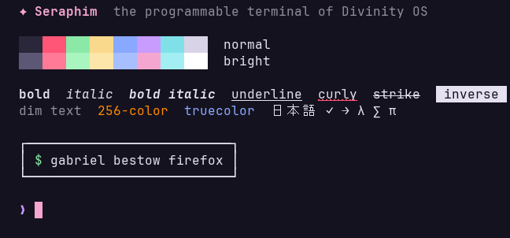
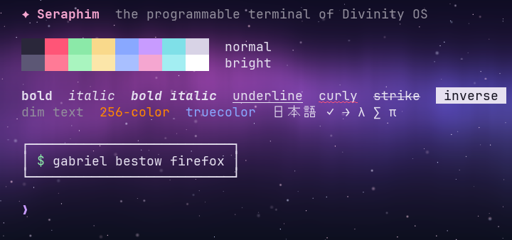
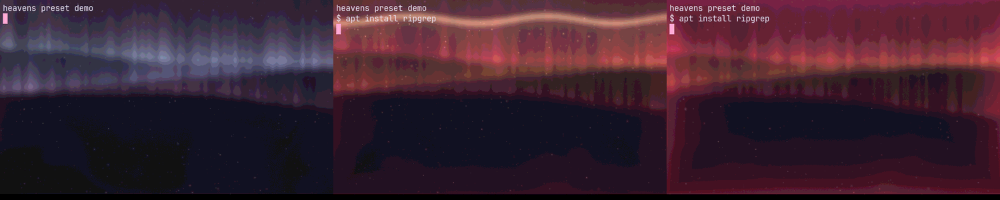
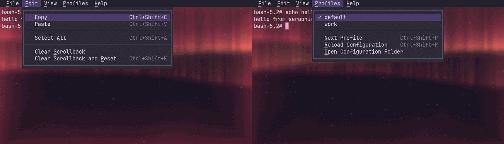
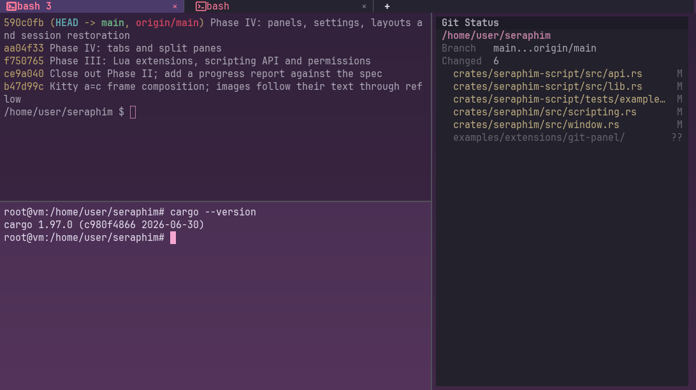
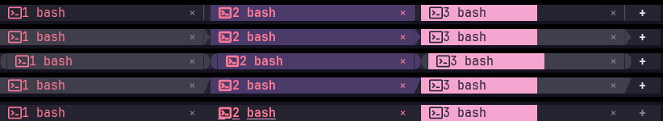
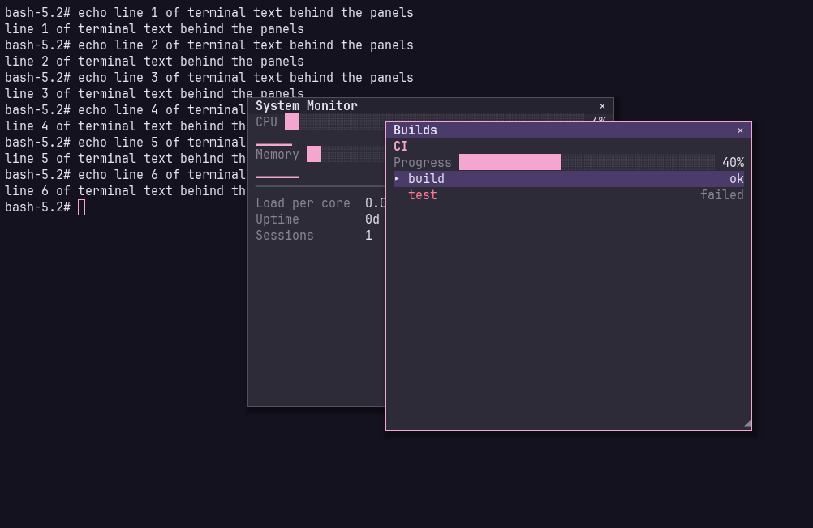
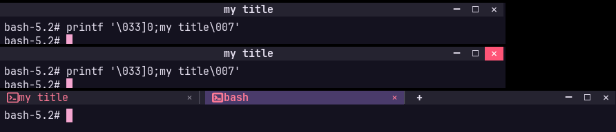
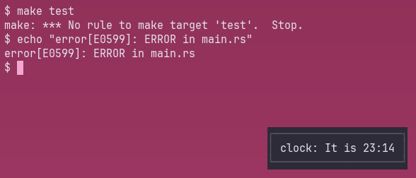
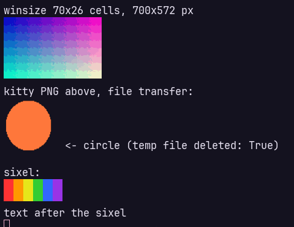

# Seraphim

The programmable terminal environment of Divinity OS.

> *A terminal that doesn't just let you customize its appearance. It lets you program its personality.*

Seraphim is a GPU-rendered terminal (Rust, wgpu) with layered, animated
backgrounds, inline images, and Lua extensions that react to what happens
in the terminal. See [`docs/adr/`](docs/adr/) for the architecture
decisions that settle spec §18.



## Status

All five phases of the specification are complete: I (functional
terminal), II (visual identity), III (programmability), IV (full
interface) and V (system integration). Phase V was rescoped: no Divinity
OS integration, Gallery or SDK, and today's package managers instead of
Gabriel. See
[docs/progress.md](docs/progress.md) for where every part of the spec
stands.

## Layout

```text
crates/
  seraphim-terminal/   Terminal Core: VT/xterm semantics, grid, scrollback, modes, input encoding (no I/O)
  seraphim-pty/        PTY creation, shell launch, resize, process metadata
  seraphim-events/     Event Bus: non-blocking, pattern-filtered pub/sub
  seraphim-session/    Sessions: PTY <-> Terminal I/O thread, event publishing, root detection
  seraphim-render/     GPU text renderer (wgpu): fonts + fallback, glyph atlas, one instanced draw
  seraphim-config/     TOML configuration loading and validation
  seraphim-visual/     Visual engine: layered backgrounds, shaders, animation, transitions
  seraphim-script/     Lua 5.4 extensions: sandbox, script thread, API, permissions
  seraphim-conformance/ Differential testing against xterm (golden screens, vttest, triage)
  seraphim/            Application: window (winit + wgpu), plus headless `run` / `replay` tools
shell-integration/     Bash/Zsh/Fish scripts emitting OSC 133 + OSC 7
examples/              Example extensions
docs/                  ADRs and phase plans
```

## Build and test

```bash
cargo test --workspace
```

The compatibility tests drive real `vim`, `less`, `tmux` and `nano` when they
are installed, and skip otherwise. Renderer pixel tests need a GPU adapter
(any Vulkan/GL driver, including lavapipe) and skip without one.

Conformance against xterm (427 recorded screens) runs as part of
`cargo test`; see [`docs/conformance.md`](docs/conformance.md) for vttest,
the xterm-refereed triage tool and the fuzzer.

Benchmarks:

```bash
cargo run --release -p seraphim-terminal --example throughput
```

```bash
cargo run --release -p seraphim-render --example frame_time
```

## Install

```bash
cargo install --path crates/seraphim --profile dist --locked --root ~/.local
seraphim --install-desktop    # menu entry and icon (KDE, GNOME, …)
seraphim --install-terminfo   # 24-bit color in tmux, undercurl, cursor shapes
```

This puts `seraphim` in `~/.local/bin` and adds it to the application menu
with its icon, for your user. The `dist` profile is the release build
without its line-level debug info (about 25 MB instead of 120). To remove
it, run `seraphim --uninstall-desktop`, then `cargo uninstall --root ~/.local seraphim`.

Packagers: the menu entry is [`extra/linux/seraphim.desktop`](extra/linux/seraphim.desktop),
the icons are in [`extra/icons/hicolor`](extra/icons) (install them under
`/usr/share/icons/hicolor`) and the terminfo source is in
[`extra/terminfo`](extra/terminfo).

## Run it

```bash
cargo run --release -p seraphim
```

opens a window running your shell. Options: `--font FAMILY`,
`--font-size PT`, `--cols N`, `--rows N`, `-e PROGRAM [ARGS...]`.

| Action | Keys / mouse |
|---|---|
| Copy selection | `Ctrl+Shift+C` (selecting also copies to PRIMARY) |
| Paste | `Ctrl+Shift+V`, `Shift+Insert`; middle-click pastes PRIMARY |
| Select | drag; double-click word; triple-click line; `Ctrl`+drag block; `Shift`+click extends |
| Scroll history | wheel, `Shift+PageUp/PageDown`, `Shift+Home/End`, `Ctrl+Shift+Up/Down` |
| Select while an app uses the mouse | hold `Shift` |

Resizing the window reflows soft-wrapped lines (scrollback included).
Applications that opt into the [Kitty keyboard
protocol](https://sw.kovidgoyal.net/kitty/keyboard-protocol/) get
unambiguous keys (Ctrl+I vs Tab, Esc vs Alt) and key release events.

Applications may set the clipboard with OSC 52; reading it requires
`--allow-clipboard-read` (or `clipboard.allow_read` in the config).

### Backgrounds, themes and profiles



Layers behind the text — solid colors, gradients, images (PNG, JPEG,
WebP, GIF; animated GIF/WebP/APNG play; blur and color grading), videos
(anything ffmpeg plays, looped, if ffmpeg is installed) and WGSL
shaders (built-in `aurora`, `starfield` and `heavens`, or your own) — are declared in
the config:

```toml
theme = "celestial"          # or "monochrome", "daylight", themes/<name>.toml

[[background]]
kind = "gradient"
colors = ["#100c22", "#2a1844", "#0d0f1f"]

[[background]]
kind = "shader"
shader = "aurora"
blend = "screen"
opacity = 0.75
params = { speed = 0.3, hue = 0.78 }
```

**Presets** bundle a scene with its interactions. The built-in `heavens`
preset is an animated sky (aurora, nebula or starfield) with two moods. It
turns red in a root shell, and a wave of light rises when you install
something:

```bash
cargo run --release -p seraphim -- --preset heavens
```



A preset is an ordinary TOML file of `[[background]]` layers and `[[on]]`
rules. Copy one to `~/.config/seraphim/presets/<name>.toml`, or write your
own, and select it with `preset = "<name>"`. Rules animate any layer
property when an event arrives on the bus:

```toml
[[background]]
id = "glow"
kind = "shader"
shader = "glow.wgsl"                # in ~/.config/seraphim/shaders/
palette = { tint = "theme.bright.5" }   # color(C_tint) in WGSL

[[on]]
event = "command.completed"
when = { exit_code = 1 }
layer = "glow"
param = "pulse"                     # p(P_pulse) in WGSL
from = 1.0
to = 0.0
duration_ms = 600
easing = "ease-out"
```

Bindings (`[[bind]]`) keep a parameter following a live value: CPU,
memory, load, battery, the time of day, or a field of the latest event.
Each new value is eased in:

```toml
[[bind]]
source = "system.cpu"               # percent
layer = "sky"
param = "speed"
output = [0.6, 2.5]                 # idle .. busy

[[bind]]
event = "command.completed"
field = "exit_code"
layer = "glow"
param = "pulse"
map = { "0" = 0.0, default = 1.0 }  # red after a failed command
```

To tweak a preset's layer, give a `[[background]]` the same `id` in your
config, e.g. `params = { style = 2 }` for the nebula. See ADR 0008 for the
design and the Lua/CSS authoring plan.

A `kind = "blur"` layer blurs everything beneath it (frosted glass over a
shader or wallpaper). Gradients animate with `spin` and `flow` parameters.
Scene changes use `visual.transition`: `fade`, `slide`, `wipe`,
`dissolve`, `zoom`, `blur`, `fade-through`, or your own `.wgsl` file
implementing `fn transition(uv, p)` with `from_scene(uv)` and
`to_scene(uv)`.

Profiles in `~/.config/seraphim/profiles/<name>.toml` override any part of
the config; switch with `--profile NAME` or **Ctrl+Shift+P** at runtime
(the background crossfades), reload with **Ctrl+Shift+R**. Animation only
draws frames while something moves, pauses when the window is unfocused, and
stops entirely with `visual.reduced_motion = true`.

### Cursor effects

The cursor glides between cells and fades when it blinks; a new selection
fades in. Optional: a soft glow, a trail while gliding, and a ripple on
every key press (`[cursor]` in the config). `visual.reduced_motion` turns
the moving ones off.

```toml
[cursor]
glide_ms = 80
glow = 0.6
ripple = true
trail = true
```

### Menu bar



File, Edit, View, Profiles and Help, laid out after Konsole's. The bar is
hidden until you tap **Alt** (Option); it opens over the terminal and hides
again when you pick something, press Esc or click elsewhere. Arrows move,
Enter runs, the underlined letter jumps. Alt+key chords still go to the
shell and don't show the bar. To keep it on screen, use **Ctrl+Shift+M**
(View → Show Menubar) or set `window.menu_bar = true`.

The menus are data (`crates/seraphim-config/src/menu.toml`), so you can
add your own from the config. An item runs an action, types text into the
shell or switches profile:

```toml
[[menu]]
title = "&Tools"
items = [
    { label = "&System Monitor", send = "htop\n" },
    { separator = true },
    { label = "&Work Profile", profile = "work" },
]
```

A `[[menu]]` titled like a built-in one appends to it (`replace = true`
replaces it).

### Tabs, splits, panels and layouts



* **Tabs:** Ctrl+Shift+T opens one and Ctrl+Shift+W closes it.
  Ctrl+PgUp/PgDown (or Ctrl+Tab) switch tabs, Alt+1…9 jump to one,
  Ctrl+Shift+PgUp/PgDown move it, and Ctrl+Alt+S renames it.
  * The tab bar appears with a second tab (`[tabs] bar`). Click to switch,
    middle-click or × to close, drag to reorder.
  * Each tab shows the program's icon. A dot marks output in a tab out of
    sight, `!` a bell, and OSC 9;4 progress fills the tab. Root tabs are
    red.
  * Choosing a profile in a tab makes it that tab's, with its own theme
    and background.
  * Drag a tab out of the window, or press Ctrl+Shift+L, to give it a
    window of its own. Its shells keep running.
  * Tab designs (`[tabs]`): `style` is `classic`, `powerline`, `rounded`,
    `slanted` or `minimal`; `position` is `top` or `bottom`; there are
    widths, buttons and `[tabs.colors]` too.

  
* **Splits:** Ctrl+Shift+E splits right and Ctrl+Shift+O down. Alt+arrows
  move between panes, Ctrl+Alt+arrows resize them, Ctrl+Shift+Z zooms
  one, and Ctrl+Shift+X closes it. Drag dividers; click a pane to focus
  it. New panes start in the current directory, and panes without focus
  are dimmed (`[panes]`).
* **Panels** (View menu): System Monitor, Sessions, Command History
  (Enter types a command again) and Package Activity, plus panels from
  extensions (`ui.panel`, see the scripting guide). View → Float or Dock
  Panel lifts the focused panel over the panes: drag its title to move
  it and its corner to resize it.

  
* **Window decorations:** `[window] decorations = "seraphim"` draws
  Seraphim's own title bar with minimize, maximize and close buttons
  (in the tab bar when it is at the top). `"none"` leaves the title bar
  out. Either way the window's edges resize it.

  
* **Settings** (Ctrl+Shift+, or Settings → Configure Seraphim): change
  the theme, preset, font, transitions, bars, effects and extensions. Each
  change is written into your config file, keeping its comments, and
  applies at once.
* **Layouts:** `[[layout]]` names an arrangement of tabs and panes:
  commands, directories and panels. Open one from the Settings menu, with
  `--layout NAME`, or at startup (`startup_layout`).
* **Restoration:** with `restore_session = true`, Seraphim saves your
  windows, tabs, splits, directories, floating panels and recent screen
  text every 30 seconds and when you quit, and the next start brings them
  back (after a crash too).

```toml
[[layout]]
name = "dev"

[[layout.tab]]
label = "code"
pane = { split = "right", ratio = 0.6, first = { cwd = "~/src" }, second = { split = "down", first = { panel = "system" }, second = { panel = "history" } } }
```

### Extensions (Lua)



Extensions are Lua 5.4 programs that react to events (output, commands,
prompts, focus, metrics, package installs…) and change layers, colors and
animations, bind properties to live values, add menu commands and
shortcuts, and more, within the permissions you grant them. Put a folder
with an `extension.toml` and `init.lua` in `~/.config/seraphim/extensions/`,
or a single file in `~/.config/seraphim/scripts/`:

```lua
-- scripts/fail.lua: tint the window red after a failed command.
visual.add_layer({ id = "fail", kind = "solid", color = "#ff2255", opacity = 0 })
seraphim.on("command.completed", function(event)
  local failed = (event.exit_code or 0) ~= 0
  visual.set_opacity("fail", failed and 0.25 or 0, { duration = 400 })
end)
```

Each extension runs in its own sandbox on a script thread. A handler that
runs too long is stopped, and one that keeps doing it is disabled; the
terminal never waits for a script. Extensions get only the permissions they
ask for *and* you grant (`[extensions.NAME]` in the config). The defaults
only change what Seraphim shows. A root shell never gives an extension more
rights, and nothing can type into a root session. See
**[docs/scripting.md](docs/scripting.md)** for the guide and API reference,
and [`examples/`](examples/) for complete extensions: an error flash,
package install effects, exit-code colors, CPU-driven intensity, a git
status panel, and a clock.

### Images



Programs can show pictures inline with the **Kitty graphics protocol**
(`kitten icat`, `timg`, `chafa -f kitty`, yazi, ...) or **Sixel**
(`img2sixel`, `chafa -f sixel`, gnuplot, ...). Images scroll with the text
into the history, move with scroll regions, and can sit under or over the
text (kitty z-index). Kitty animations play, Unicode placeholders work (so
images show through tmux), and local tools can hand images over through
shared memory or files. The PTY reports pixel sizes, so tools size
pictures correctly. Tested with `kitten icat`, `chafa`, `img2sixel`, `timg`
and tmux; see [docs/image-tools.md](docs/image-tools.md).

For 24-bit color and images inside tmux (and undercurl and cursor shapes
in programs that read terminfo), install Seraphim's terminfo entry once:

```bash
seraphim --install-terminfo
```

New sessions then use `TERM=xterm-seraphim`. Hosts you ssh into need the
entry too, or set `terminal.term = "xterm-256color"`.

### Performance

Seraphim draws a frame only when something changed, and then rebuilds only
the rows that changed and uploads only the bytes that differ. `seraphim
bench` measures parser throughput, frame preparation and GPU frame times on
your machine, and `seraphim bench --window` does the same in a real
window, including time to first frame and key-to-echo latency.
`SERAPHIM_TIMING=1 seraphim` logs those during normal use. Results
(RTX 2060 Super, Radeon Pro WX 7100, software rendering) are in
[docs/benchmarks.md](docs/benchmarks.md).

With more than one GPU, pick one with `SERAPHIM_GPU`, giving any part of
its name (`SERAPHIM_GPU=2060 seraphim`); `seraphim bench --list-gpus`
shows the names. Seraphim uses Vulkan, and falls back to OpenGL only when
no Vulkan GPU can draw to the window (`WGPU_BACKEND=gl` forces it).

### Configuration

Settings live in `~/.config/seraphim/config.toml` (font, window size,
colors, scrollback, shell, clipboard policy). Print the documented defaults
with:

```bash
cargo run -p seraphim -- --print-default-config
```

Changes apply as soon as you save: Seraphim watches the config, the active
profile, theme and preset files, and any shaders and images they use
(`live_reload = false` turns this off; Ctrl+Shift+R reloads by hand). A
notice in the corner says when it reloaded, or what is wrong; a broken
file leaves the current look in place until it is fixed.

Unknown keys and invalid values are reported with their line and column;
a broken config never stops the terminal from opening (it falls back to the
defaults and says why). Command-line options override the file;
`--config PATH` uses another file. `SERAPHIM_DEBUG_INPUT=1` logs raw input events.

Linux build dependencies: a Vulkan or GL driver, plus the usual X11/Wayland
client libraries (`libxkbcommon`, `libwayland-client`). With no GPU,
Mesa's software Vulkan (`mesa-vulkan-drivers`, "lavapipe") works.

### Headless tools

`seraphim run` runs a program in a PTY-backed session without a window, then
prints the final screen and every published event. This example emits by
hand the same sequences the shell integration sends around a command:

```bash
cargo run -p seraphim -- run --cols 40 --rows 4 --events -- sh -c 'printf "\033]133;C;cmdline_url=pacman%%20-S%%20firefox\a"; sleep 0.3; printf "(1/1) installing firefox\r\n\033]133;D;0\a"'
```

```text
event command.started    session=Some(1) {"command":"pacman -S firefox"}
event package.install.started session=Some(1) {"manager":"pacman","operation":"install","package":"firefox","packages":["firefox"],…}
event package.install.progress session=Some(1) {"done":1,"total":1,"percent":100,…}
event package.install.completed session=Some(1) {"exit_code":0,"duration_ms":301,…}
event command.completed  session=Some(1) {"command":"pacman -S firefox","duration_ms":301,"exit_code":0}
```

`seraphim replay FILE` feeds a recorded byte stream (e.g. from
`script -q -c CMD out.log`) through the parser, useful for reproducing
rendering bugs.

## Shell integration

Add to your shell's rc file:

```bash
[[ $TERM_PROGRAM == seraphim ]] && source /path/to/seraphim/shell-integration/seraphim.bash
```

This lets Seraphim publish `shell.prompt`, `command.started`,
`command.completed` (with exit code and duration) and `session.cwd.changed`
without modifying any program it runs. The package manager reactions
build on these events.

## Package managers

Seraphim recognizes package managers at work: emerge (Portage), pacman,
paru, yay, apt, nala, dnf, yum, zypper, xbps, apk, eopkg, nix, flatpak,
snap and brew, through `sudo`, `doas`, `run0` or `pkexec`. It follows
their progress in their own output, and shows it in the tab and in the
Package Activity panel. It also publishes `package.<operation>.<phase>`
events (`package.install.started`, `package.upgrade.progress`,
`package.remove.failed`, …) for rules and extensions. The `heavens`
preset reacts to installs and upgrades. Shell integration adds exit
codes; without it, Seraphim watches the foreground process.

## System integration

* **Monitoring:** CPU, memory, load, battery, GPU (AMD and Intel from
  sysfs, NVIDIA through `nvidia-smi`), temperatures, network and disk
  rates. They show in the System Monitor panel, and backgrounds can follow
  them with `[[bind]] source = "system.gpu"`, `"network.rx"`,
  `"disk.write"` and others. `network.online` and `network.offline`
  events fire when the connection comes or goes.
* **Notifications:** programs can ask for desktop notifications (OSC 9,
  OSC 777, OSC 99). Seraphim sends its own when a long command, a package
  manager or the bell finishes while you can't see it (`[notifications]`).
* **Audio:** `[audio] bell` makes the bell audible, and `[[sound]]` plays
  a sound when an event arrives. `audio.level`, `audio.bass`, `audio.mid`
  and `audio.treble` let backgrounds react to the music you're playing.
  Seraphim uses `pw-play`, `paplay` or `ffplay` and `parec`, with no audio
  library.
